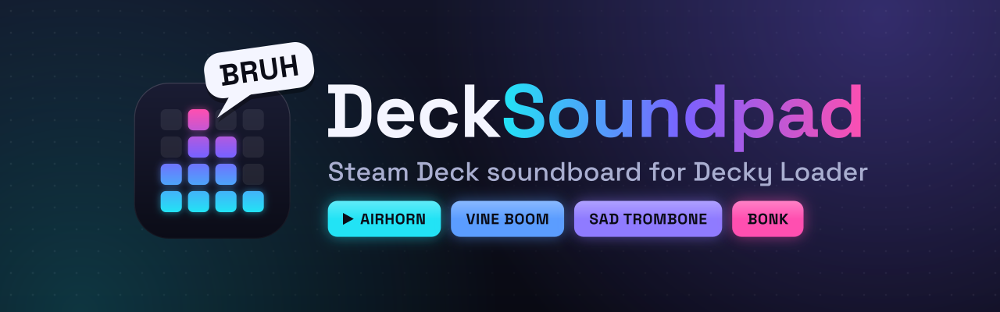
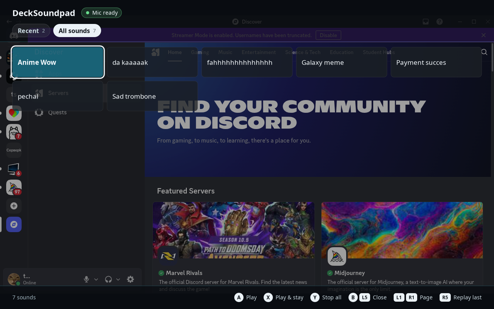
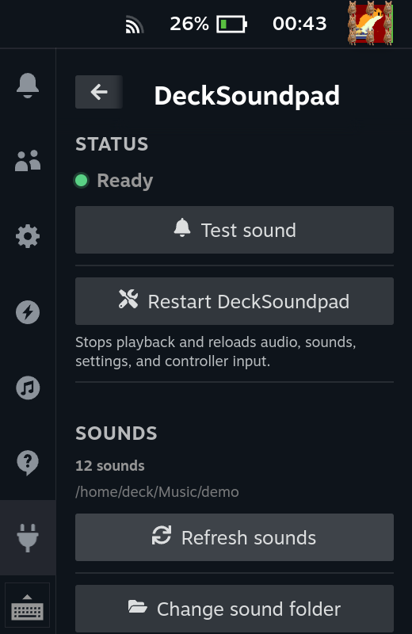
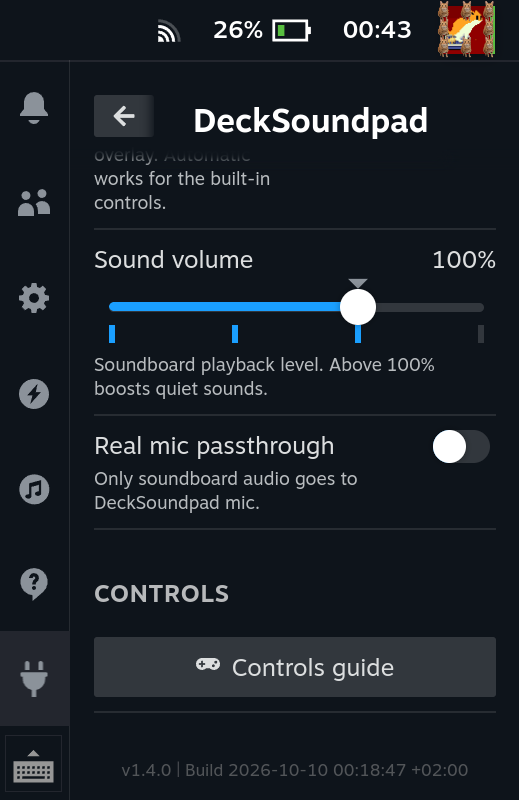
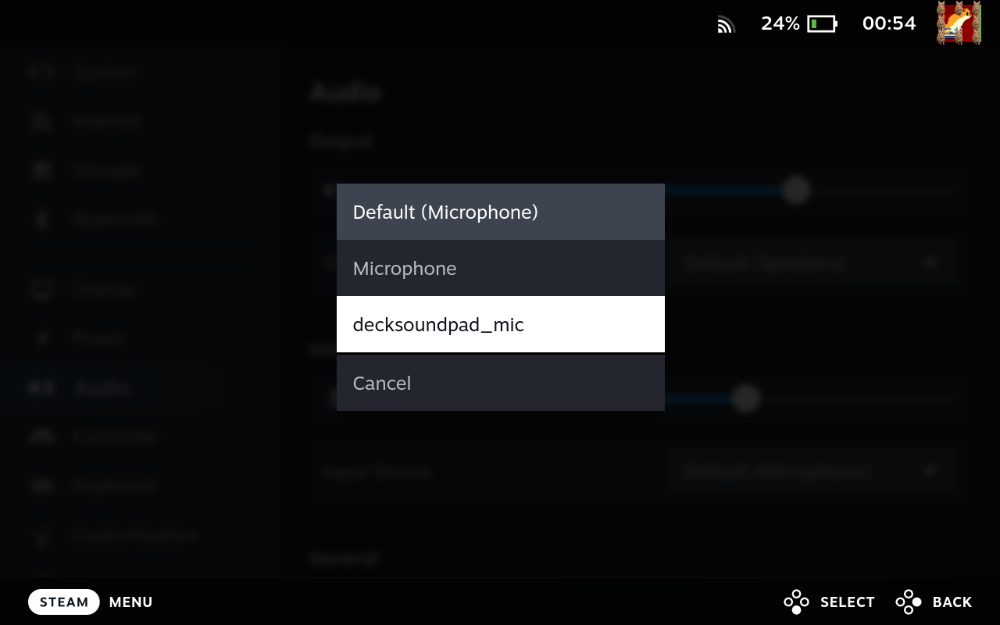

<p align="center">
  
</p>

# DeckSoundpad

DeckSoundpad is a Steam Deck soundboard for Decky Loader. It mixes your sounds
and real microphone into one virtual input named `DeckSoundpad mic`.

The plugin is still being prepared for its first public release. Hardware
validation on a real Steam Deck is required before compatibility claims are
final.

## What it does

- Plays WAV, FLAC, OGG, and MP3 files from a local sound library.
- Opens an in-game sound picker from L4, L5, R4, or R5, with a Recent tab and
  one tab per sound folder. R5 replays the last sound without opening it.
- Mixes sounds with an optional real microphone.
- Exposes the mix as `DeckSoundpad mic` for Discord, Steam Voice, games, and
  browser calls.
- Repairs a broken audio route when you play a sound, and reopens controllers
  after sleep or device changes.

## Screenshots

The in-game sound picker, opened from a rear button over Discord:



The Decky panel:

<p align="center">
  
  
</p>

Steam's audio settings list the virtual mic as `decksoundpad_mic`:



## Requirements

- Steam Deck with SteamOS
- Decky Loader
- PipeWire/PulseAudio compatibility tools

DeckSoundpad does not change the read-only SteamOS filesystem, install system
packages, or expose a network API. Controller hotkeys need access to the
matching `/dev/input` or `/dev/hidraw` device. See the
[no-root rationale](https://github.com/chrpk/decksoundpad/blob/main/docs/ROOT_PERMISSION_RATIONALE.md) and
[compatibility notes](docs/COMPATIBILITY.md).

## Install

DeckSoundpad is not available in the Decky Loader plugin store yet. We are
working to get it listed there. Until then, install it manually from a GitHub
Release.

Download `DeckSoundpad-vX.Y.Z-full.zip` and its `.sha256` file from a GitHub
Release. Verify the checksum, then install the ZIP through Decky Loader's
plugin developer tools.

For updates, rollback, manual installation, and removal, read the
[installation guide](docs/INSTALLATION.md).

## Add sounds

Copy sound files to:

```text
~/Music/DeckSoundpad
```

Open DeckSoundpad and select **Refresh sounds**. To use another folder, select
**Change sound folder** and pick it; DeckSoundpad loads its sounds right away.
Custom library roots must be real directories owned by the Steam user. DeckSoundpad rejects symlink roots
and files owned by another user.

WAV is the safest format. Compressed formats need a compatible local player,
such as `ffmpeg`, `mpv`, or `pw-play`.

## Use

1. Open DeckSoundpad in the Decky panel.
2. Select **Restart DeckSoundpad**.
3. Choose `DeckSoundpad mic` in your game or voice app.
4. Leave Controller input on **Automatic**, or choose a detected controller.
5. Pick L4, L5, R4, or R5 for the overlay.

**Restart DeckSoundpad** is a full reset. It stops playback and controller
listeners, closes the overlay, rebuilds the audio route, reloads settings,
rescans sounds, and starts fresh workers.

External controllers must expose rear buttons as Linux `BTN_GRIP*` events.
Controllers without rear buttons cannot use the current hotkeys.

## If something breaks

Start with **Restart DeckSoundpad**. Then check:

```text
~/Public/DeckSoundpad/logs/bridge.log
~/Public/DeckSoundpad/logs/backend.log
~/Public/DeckSoundpad/logs/external-overlay.log
```

Common fixes:

- Missing virtual mic: restart DeckSoundpad, then check
  `pactl list sources short | grep decksoundpad`.
- Sound is absent in Discord: select `DeckSoundpad mic` as Discord's input.
- Audio broke after sleep: play a sound to start a route repair, then try again
  after a moment. If audio is still broken, restart DeckSoundpad.
- MP3 does not play: try WAV or check whether a compressed-audio player is
  available.

Read [troubleshooting](docs/TROUBLESHOOTING.md) for more cases. Before opening
an issue, follow the [diagnostics guide](docs/DIAGNOSTICS.md) and redact local
usernames, paths, device names, tokens, and private filenames.

## Build and test

Use Node 22 and pnpm 9.15.9:

```bash
nvm use
corepack enable
corepack pnpm install
corepack pnpm run check
corepack pnpm run package
```

The package command writes the ZIP and checksum to `out/`.

Backend tests can also run directly:

```bash
python3 -m unittest discover -s backend/tests -p 'test_*.py'
```

Set `DECKSOUNDPAD_SIMULATE=1` to test the backend without SteamOS, PipeWire, or
Deck hardware. Simulation records playback in memory and does not change the
production audio path.

## Project docs

For users:

- [Installation and removal](docs/INSTALLATION.md)
- [Troubleshooting](docs/TROUBLESHOOTING.md)
- [Diagnostics](docs/DIAGNOSTICS.md)
- [Privacy](docs/PRIVACY.md)
- [Support](SUPPORT.md)

Repository-only docs for contributors and maintainers:

- [Contributing](https://github.com/chrpk/decksoundpad/blob/main/CONTRIBUTING.md)
- [Architecture](https://github.com/chrpk/decksoundpad/blob/main/docs/ARCHITECTURE.md)
- [Decky bridge API](https://github.com/chrpk/decksoundpad/blob/main/docs/BRIDGE_API.md)

Dependency and icon notices are in
[third-party notices](docs/THIRD_PARTY_NOTICES.md), with full bundled license
text in [third-party licenses](docs/THIRD_PARTY_LICENSES.md).

## Security and license

Follow [SECURITY.md](SECURITY.md) for vulnerability reports and never put exploit details in
a public issue. DeckSoundpad is licensed under the MIT License.
